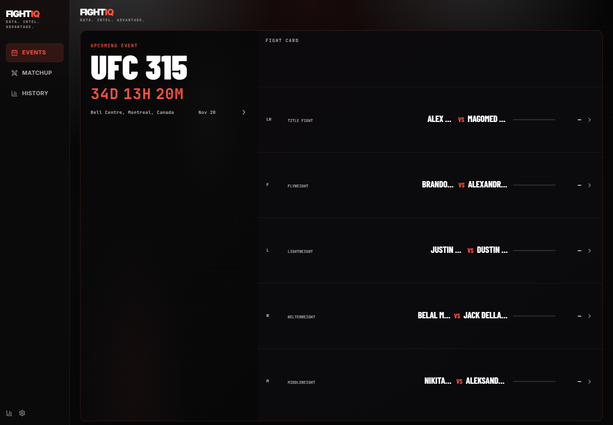
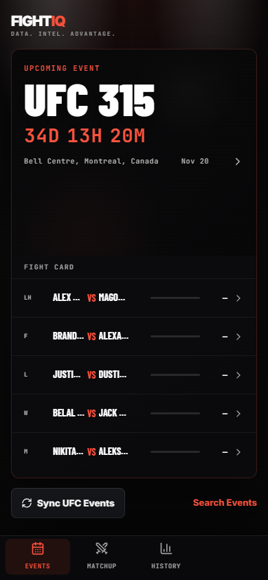
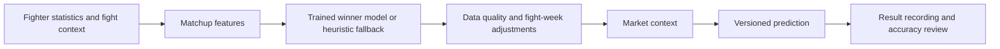

# FightIQ · UFC Fight Prediction Model

A full-stack MMA analytics project for exploring UFC cards, comparing fighters, generating predictions, and reviewing results over time.

FightIQ brings fighter statistics, matchup features, fight-week intelligence, and market context into one dashboard. Predictions retain their model version and supporting data so you can revisit what the system knew before a fight.

**React + TypeScript · FastAPI · SQLAlchemy · scikit-learn**

[Quick start](#quick-start) · [How it works](#how-it-works) · [Run guide](docs/run-website.md) · [Prediction rules](PREDICTION_RULES.md)

## Preview



<details>
<summary>View the mobile dashboard</summary>



</details>

Screenshots of the running frontend with built-in demo data, captured at 1440 × 1000 and 390 × 844. Event names, matchups, and relative dates are sample content, not a live UFC schedule or measured prediction results. See [screenshot notes](docs/images/README.md).

## What you can explore

- **Events and matchups:** browse cards, compare fighter profiles, and analyze individual fights or a card.
- **Prediction context:** inspect win probabilities, confidence, method leans, and key factors.
- **Fight-week intelligence:** collect or enter injury, camp, weight-cut, and weigh-in signals.
- **Market comparisons:** compare model probabilities with implied odds and line movement.
- **Prediction history:** preserve prediction versions and inspect accuracy after results are recorded.

The repository includes the API, frontend, data collectors, training utilities, migrations, and backend tests. A fresh checkout does not include a trained model or historical dataset; local databases and model artifacts are generated separately.

## Quick start

You need Git, Python with `venv`, and Node.js with npm. These commands use PowerShell; the [full guide](docs/run-website.md) also covers macOS/Linux and phone access. The pinned backend dependencies were installed with Python 3.14 on Windows for this documentation refresh.

```powershell
git clone https://github.com/AzatKabulov/ufc-fight-prediction-model.git
cd ufc-fight-prediction-model
```

### 1. Start the API

```powershell
cd backend
python -m venv .venv
.\.venv\Scripts\python -m pip install -r requirements.txt
Copy-Item .env.example .env
.\.venv\Scripts\python -m uvicorn app.main:app --reload --host 127.0.0.1 --port 8010
```

Startup creates a local SQLite database and seed records. Open the [health check](http://127.0.0.1:8010/health) or [interactive API docs](http://127.0.0.1:8010/docs).

### 2. Start the dashboard

In a second terminal, from the repository root:

```powershell
cd frontend
npm ci
Copy-Item .env.example .env.local
npm run dev -- --host 127.0.0.1
```

Open [FightIQ locally](http://127.0.0.1:5179). Copy environment examples only on first setup to avoid overwriting your local settings.

For a visual preview, you can run just the frontend. The events view falls back to bundled sample data when its API request fails. Fight details, analysis, history, and admin operations need a working backend; offline fallback does not cover every screen.

### 3. Explore the workflow

1. Browse the seeded card to inspect the interface.
2. Choose **Sync UFC Events** to request source-backed upcoming events. This requires network access and availability of the source site.
3. Open a future booked fight and run analysis. The backend refreshes available fighter data, builds features, and saves a prediction.
4. Use prediction history and result-recording workflows to review completed fights.

## How it works



Historical training and on-demand analysis are separate workflows. The code includes chronological feature construction, Elo features, model registration, and rolling holdout validation. When a suitable trained model is unavailable, analysis can use a heuristic fallback. Displayed probabilities alone are not evidence of validated predictive accuracy.

The system keeps base, adjusted, and market-related probabilities distinct for later comparison. See [architecture](docs/architecture.md), [model notes](ml/README.md), and [prediction rules](PREDICTION_RULES.md) for implementation details and intended methodology.

## Project map

| Location | Purpose |
| --- | --- |
| [`frontend/`](frontend/) | React dashboard, API client, and bundled preview data |
| [`backend/app/main.py`](backend/app/main.py) | FastAPI routes and startup |
| [`backend/app/services/`](backend/app/services/) | Features, predictions, collectors, odds, and result tracking |
| [`backend/migrations/`](backend/migrations/) | Alembic database migrations |
| [`backend/tests/`](backend/tests/) | Python unittest suite |
| [`docs/`](docs/) | Architecture, setup instructions, and screenshots |
| [`ml/`](ml/) | Training notes and artifact directory |
| [`scrapers/`](scrapers/) | Collector notes; active adapters live in backend services |
| [`PRODUCT.md`](PRODUCT.md) | Product purpose and design principles |

## Verify your checkout

From `backend/`, with dependencies installed:

```powershell
.\.venv\Scripts\python -m unittest discover -s tests -v
```

From `frontend/`:

```powershell
npm run build
```

The frontend build checks TypeScript and produces a Vite bundle. The backend suite covers API, feature, model, odds, training, and source-parsing workflows. Check test counts and results on the version you run.

## Status and limitations

FightIQ is a personal research and portfolio project. Data coverage, source availability, model artifacts, and validation quality affect its outputs. Market signals are included for analysis; there is no published performance guarantee.

The current setup is intended for local development. Admin routes do not currently enforce the configured `ADMIN_API_KEY`; setting it alone does not secure the API. Authentication and access controls need implementation before public hosting. Without APScheduler, the fallback scheduler registers jobs but does not execute periodic work; APScheduler is not included in the pinned requirements.

Near-term work includes broader historical coverage, dependency maintenance, better fighter identity matching, and comparisons of model-only, intelligence-adjusted, and market-blended outputs.

## Contributing

Open an issue with reproduction steps for a bug or the intended outcome for an improvement. Keep pull requests focused, run checks relevant to the change, and include screenshots for UI updates. Use synthetic examples rather than committing local databases, API keys, or generated model artifacts.
